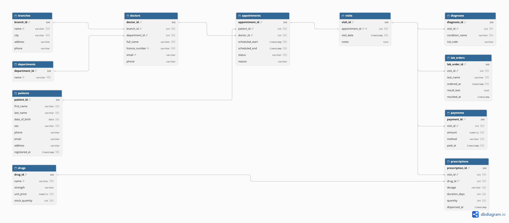

# MIT 8103 Advanced Database Systems: Final Summary

**CareBridge Clinics** | Shakirat Akanji, MSc Information Technology | Student number: 301928526

GitHub: [Anikhe00/Akanji-Shakirat-301928526](https://github.com/Anikhe00/Akanji-Shakirat-301928526)

## 1. Project overview

This project designs, queries, secures and distributes one database for a simulated organisation, **CareBridge Clinics**: three private outpatient clinics in Oyo State, Nigeria, with 20,000 patients and about 80,000 visits of simulated data. All data is invented and no real patient data is used. The same case study runs through all five portfolios.

- **Organisation and business:** three clinics (Ibadan, Oyo Town and a third branch) offering consultations, prescriptions, laboratory tests and a pharmacy.
- **Users:** receptionists (booking), doctors (visits and diagnoses), nurses and pharmacy staff (dispensing), billing staff (payments) and managers (reports).
- **Major data:** branches, doctors, patients, appointments, visits, diagnoses, prescriptions, drugs and stock, lab orders and payments.
- **Key operations:** book appointments without double-booking a doctor, record visits, dispense drugs and keep stock correct, take payments, retrieve a patient's full history, and report on common diagnoses and top payers.

| Item | Detail |
| --- | --- |
| Relational database | PostgreSQL 16 (Docker) |
| Document database | MongoDB 7 (Docker) and MongoDB Atlas M0 (cloud) |
| Other tools | Docker Compose, psql, mongosh, Git and GitHub |

Figure 1. The 11-table CareBridge schema. Primary keys identify rows, and foreign keys link appointments, visits, prescriptions, payments and the other tables to their parents.

## 2. Summary of the five portfolios

Each portfolio builds on the one before it, so the final system is a relational core with a document view and a replicated, cloud-hosted copy.

| Portfolio | What was built | Key result | Key decision |
| --- | --- | --- | --- |
| 1. Database design | 11-table PostgreSQL schema with keys, CHECK and UNIQUE rules [1], loaded with 20,000 patients and about 80,000 visits | Five invalid statements were rejected, e.g. stock below 0 and two bookings for one doctor at one time | Normalised tables (3NF), with rules in the database and not only in application code |
| 2. Query optimisation | Five slow queries analysed with EXPLAIN ANALYZE [2], then indexed | Three of the five queries improved, by about 2.5 to 36 times (e.g. patient history 12.8 ms to 0.44 ms); two did not change, because they scan the whole table or already used an index | Index only the columns that queries filter or join on |
| 3. Transactions and concurrency | Four demos: rollback, lost update, isolation levels, double booking [3][4] | Without a lock the final stock was 6 instead of 0; with FOR UPDATE it was 0. The second read was 7 under READ COMMITTED and 10 under REPEATABLE READ. Concurrent booking left exactly 1 appointment | Use row locks and database constraints so rules hold under concurrency |
| 4. NoSQL (MongoDB) | 200 patients remodelled as documents with visits embedded [5] | A whole record in one read (patient 100: 30 visits). An index changed a collection scan of 200 documents to 1 | Embed what is read together; keep stock and money in PostgreSQL |
| 5. Distributed and cloud | PostgreSQL primary and replica on Docker [6]; 3-node MongoDB Atlas replica set [7] | A paused replica was 112 bytes behind and returned stale stock 10 against 8; the promoted replica accepted writes; an Atlas `w: "majority"` write was acknowledged and a secondary served a read | Writes and stock go to the primary; reports can read from replicas. A hashed patient id is the proposed shard key [8] |

**Overall conclusion.** PostgreSQL stays the system of record for appointments, billing and drug stock, where correctness matters. MongoDB holds the patient-record view for fast reads. Replication adds availability, at the cost of possibly stale reads from replicas, which is the trade-off described by the CAP discussion [9].

**Limitations.** Timings come from one laptop and do not predict every workload. The MongoDB view covers 200 of the 20,000 patients. Docker MongoDB runs without authentication, which is acceptable for simulated data only. Sharding is a design discussion and was not implemented.

## 3. Evidence

Scripts, results, limitations and screenshots are in each portfolio's folder: [P1 design and constraint tests](https://github.com/Anikhe00/Akanji-Shakirat-301928526/tree/main/portfolio-1-database-design), [P2 plans and timings](https://github.com/Anikhe00/Akanji-Shakirat-301928526/tree/main/portfolio-2-query-optimisation), [P3 transactions](https://github.com/Anikhe00/Akanji-Shakirat-301928526/tree/main/portfolio-3-transactions-concurrency), [P4 MongoDB](https://github.com/Anikhe00/Akanji-Shakirat-301928526/tree/main/portfolio-4-nosql), [P5 replication and Atlas](https://github.com/Anikhe00/Akanji-Shakirat-301928526/tree/main/portfolio-5-distributed-cloud). Screenshots are in each folder's `evidence/` subfolder, and Portfolios 2 to 5 also save the full text output.

## 4. Individual reflection

The hardest part was getting the tools to run, not the SQL. When I changed laptops, Docker Desktop failed with a corrupted disk image, so I rebuilt the containers and the 20,000-patient database. In Portfolio 5 the primary server kept exiting because a startup script could not run inside the container, so I replaced it with a plain SQL file. In Atlas, an error message printed my database password, so I deleted that output, changed the password and made the script hide it. These problems taught me to read error messages and container logs first, and to treat passwords as something that can leak through output.

The idea I understand best is the lost update. Two sessions both read a stock of 10, and the final stock was 6 instead of 0 because one nurse's dispensing was overwritten. SELECT ... FOR UPDATE fixed it by making the second session wait and then see the latest value. If I started again, I would commit to GitHub after every small step and build the replication demo earlier, because it took the most time.

For a real clinic I would use both databases: PostgreSQL for appointments, billing and stock, and MongoDB for patient-history reads. Replicas could serve reports but not stock checks, because a paused replica showed 10 when the primary showed 8.

## 5. AI-use declaration

Claude (Anthropic), via Claude Code and the Claude app, was used to propose the design and demo scenarios; write the SQL, shell and mongosh scripts and the Docker Compose file; help debug setup problems (Docker Desktop errors, a script permission error in a container, an Atlas network access error); draft each portfolio README from the output of scripts I ran; and help structure this document. I ran every script myself on my own machine, Docker containers and Atlas cluster, read each result and compared it with what the README said. A database password appeared in one error message; I deleted that output, changed the Atlas password, and the script now hides the connection string. I can explain each part of the work.

## 6. References

[1] PostgreSQL Global Development Group. *PostgreSQL 16: Constraints.* https://www.postgresql.org/docs/16/ddl-constraints.html

[2] PostgreSQL Global Development Group. *PostgreSQL 16: Using EXPLAIN.* https://www.postgresql.org/docs/16/using-explain.html

[3] PostgreSQL Global Development Group. *PostgreSQL 16: Transaction Isolation.* https://www.postgresql.org/docs/16/transaction-iso.html

[4] PostgreSQL Global Development Group. *PostgreSQL 16: Explicit Locking.* https://www.postgresql.org/docs/16/explicit-locking.html

[5] MongoDB. *Data Modeling.* https://www.mongodb.com/docs/manual/data-modeling/

[6] PostgreSQL Global Development Group. *PostgreSQL 16: Log-Shipping Standby Servers (Streaming Replication).* https://www.postgresql.org/docs/16/warm-standby.html

[7] MongoDB. *Replication.* https://www.mongodb.com/docs/manual/replication/

[8] MongoDB. *Sharding.* https://www.mongodb.com/docs/manual/sharding/

[9] Brewer, E. (2012). CAP twelve years later: How the "rules" have changed. *IEEE Computer*, 45(2), 23-29.

Per-portfolio reference lists are in each folder's README. All clinic data is simulated.
