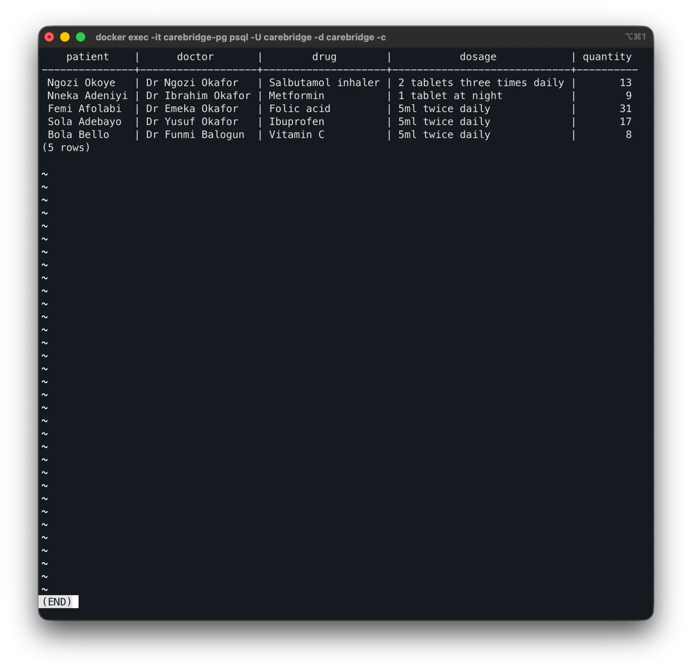

# Portfolio 1: Evidence

The screenshots are in the `evidence/` subfolder and come from my own terminal. The statements shown in them are in `Akanji_Shakirat_301928526_P1_ConstraintTests.sql`, which can be run again to repeat all five tests.

| # | Test | Rule that rejects it | Screenshot |
| --- | --- | --- | --- |
| 1 | Book Dr Okafor twice at 09:00 | `UNIQUE (doctor_id, scheduled_start)` | [Double booking](evidence/Akanji_Shakirat_301928526_P1_ConstraintDoubleBooking.png) |
| 2 | Insert a patient with sex `unknown` | `CHECK (sex IN ('female','male','other'))` | [Wrong sex value](evidence/Akanji_Shakirat_301928526_P1_ConstraintWrongSexValue.png) |
| 3 | Set drug stock to -5 | `CHECK (stock_quantity >= 0)` | [Negative drug stock](evidence/Akanji_Shakirat_301928526_P1_ConstraintNegativeDrugStock.png) |
| 4 | Insert a payment for visit 999 | foreign key `payments.visit_id` | [Payment for invalid visit](evidence/Akanji_Shakirat_301928526_P1_ConstraintPaymentForInvalidVisit.png) |
| 5 | Delete a patient who has appointments | foreign key `appointments.patient_id` | [Delete patient with appointment](evidence/Akanji_Shakirat_301928526_P1_ConstraintDeletePatientWithAppointment.png) |

All five statements were rejected by the database, and no data changed.

## Join query

`Akanji_Shakirat_301928526_P1_JoinPrescriptions.sql` joins `prescriptions`, `visits`, `appointments`, `patients`, `doctors` and `drugs`. It finds the patient and the doctor behind each prescription through foreign keys, without storing them twice in `prescriptions`. The screenshot shows the first five rows from the full 20,000-patient database.

