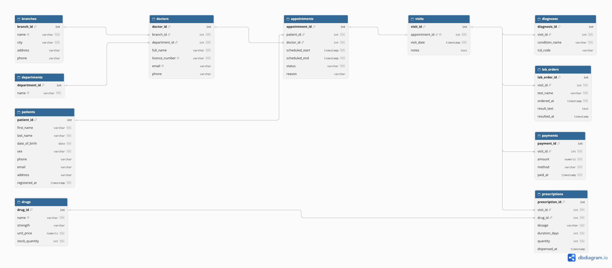

# Portfolio 1: Database Design and Modelling

## 1. Case study

**Organisation:** CareBridge Clinics, a simulated network of three private clinics in Oyo State, Nigeria (Ibadan, Ogbomoso and Oyo Town).

**System:** An integrated patient management database covering registration, appointments, consultations, diagnoses, prescriptions, laboratory tests and billing.

**Users:** Receptionists, doctors, nurses, pharmacists, lab technicians, billing staff and clinic administrators.

**Key operations:** book appointments without double-booking, record diagnoses, retrieve a patient's history, issue and dispense prescriptions, order lab tests and take payments.

All data in this repository is invented. No real patient information is used.

This same case study is used in all five portfolios.

## 2. Files in this folder

| File | Purpose |
|---|---|
| `carebridge.dbml` | ER design in DBML, used to draw the diagram on dbdiagram.io |
| `er-diagram.png` | Exported ER diagram |
| `schema.sql` | PostgreSQL `CREATE TABLE` statements with keys and constraints |
| `seed_sample.sql` | Small hand-written sample data used to test the design |
| `evidence/` | Screenshots of the constraint tests and a join query |

## 3. ER diagram

The database has 11 tables:

| Table | What one row represents |
|---|---|
| `branches` | One of the three clinics |
| `departments` | A department such as Paediatrics or Pharmacy |
| `doctors` | A doctor, working at one branch in one department |
| `patients` | A registered patient |
| `appointments` | A booking of one patient with one doctor at a time slot |
| `visits` | What happened when the patient attended an appointment |
| `diagnoses` | A condition recorded during a visit |
| `drugs` | A medicine in the catalogue, with price and stock |
| `prescriptions` | One drug prescribed during one visit |
| `lab_orders` | A lab test ordered during a visit, with its result |
| `payments` | A payment made for a visit |

### Relationships

- One branch has many doctors (`doctors.branch_id`). One department has many doctors (`doctors.department_id`).
- One patient has many appointments (`appointments.patient_id`). One doctor has many appointments (`appointments.doctor_id`).
- One appointment has at most one visit (`visits.appointment_id`, unique).
- One visit has many diagnoses, prescriptions, lab orders and payments. Each of these tables holds `visit_id`.
- One drug appears in many prescriptions (`prescriptions.drug_id`).
- Visits and drugs are in a many-to-many relationship. `prescriptions` is the junction table that resolves it, and it also stores facts about the link itself (dosage, duration, quantity, dispensing time).

`visits` is the central table of the design, because the diagnosis, prescriptions, lab tests and payment all belong to a visit.

## 4. Keys and constraints

Every table has a primary key that is an auto-generated integer (`GENERATED ALWAYS AS IDENTITY`). Foreign keys are declared with `REFERENCES`, so the database rejects links to rows that do not exist.

| Rule | Where | Why it exists |
|---|---|---|
| `UNIQUE (doctor_id, scheduled_start)` | `appointments` | A doctor cannot be booked twice at the same time |
| `UNIQUE` on `appointment_id` | `visits` | One visit per appointment |
| `UNIQUE` on `licence_number`, branch name, department name, drug name | various | No duplicate doctors, branches, departments or drugs |
| `CHECK (sex IN ('female','male','other'))` | `patients` | Only valid values are stored |
| `CHECK (date_of_birth <= CURRENT_DATE)` | `patients` | No birth dates in the future |
| `CHECK (scheduled_end > scheduled_start)` | `appointments` | An appointment must end after it starts |
| `CHECK (status IN (...))` | `appointments` | Only the four allowed statuses |
| `CHECK (stock_quantity >= 0)` and `CHECK (unit_price >= 0)` | `drugs` | Stock and price cannot be negative |
| `CHECK (duration_days > 0)` and `CHECK (quantity > 0)` | `prescriptions` | A prescription must be for a real amount |
| `CHECK (amount > 0)` and `CHECK (method IN (...))` | `payments` | Real payments with a known method |
| `NOT NULL` on required columns | throughout | Essential facts cannot be left empty |

Money is stored as `NUMERIC(10,2)` or `NUMERIC(12,2)`, never as a floating-point type, so amounts are exact. Timestamps use `TIMESTAMPTZ` so times keep their time zone.

## 5. Design decisions and assumptions

1. **One visit per appointment.** Walk-in patients without an appointment are not modelled. This keeps the design simple, and it is listed as future work below.
2. **`prescriptions` is a junction table.** A visit can have several prescriptions and a drug appears in many prescriptions, so a table sits between them.
3. **Patient and doctor are not repeated in `prescriptions`.** They can be reached through the chain `prescriptions -> visits -> appointments -> patients / doctors`. Storing them again would duplicate facts.
4. **Deletes are restricted, not cascading.** See section 7.
5. **PostgreSQL 16 in Docker.** The database runs from `docker-compose.yml` in the repository root.

## 6. Normalisation

**1NF (one value per cell, no repeating groups).** Suppose `visits` had a column `drugs_prescribed` containing "Artemether, Paracetamol". That would make it hard to count how often one drug is prescribed, there would be nowhere to store the dosage and quantity for each drug, and nothing would stop a drug that is not in the catalogue from being typed in. The design avoids this by giving each prescribed drug its own row in `prescriptions`. Multiple diagnoses are handled the same way, with one row each in `diagnoses`.

**2NF (every column depends on the whole key).** This only matters when a primary key has more than one column. Every table here has a single-column key, so 2NF is satisfied automatically.

**3NF (every column depends on the key and nothing else).** A mistake I could have made is putting `doctor_id` in `prescriptions`. The doctor is already determined by the visit, because the visit belongs to an appointment and the appointment belongs to one doctor. That would make `doctor_id` depend on `visit_id`, which is not the key, and the two copies of the doctor could disagree. The same applies to `patient_id`. Keeping them out of `prescriptions` avoids the problem. A second example is `branch_city`: it describes the branch, so it is stored only in `branches`, and `doctors` links to it with `branch_id`.

All tables are in 3NF.

## 7. Deleting records

PostgreSQL refuses to delete a patient who has appointments. This is the right behaviour for a clinic. A patient's appointments, visits, diagnoses, prescriptions and payments are medical and financial records that must be kept as history, even if the patient stops attending. The foreign key also prevents accidental deletion that would leave appointments and payments pointing at a patient who no longer exists. The check does not depend on the appointment status, since it only sees that other rows still reference the patient (in my test the appointment was `completed`, not pending).

I did not use `ON DELETE CASCADE`, because it would silently delete the patient's whole record. A real system would mark a patient as inactive (for example with an `is_active` column) instead of deleting them.

## 8. Testing and evidence

I loaded the sample data in `seed_sample.sql` and then tried to break the rules. All five attempts were rejected by the database:

| # | Attempt | Rejected by | Evidence file |
|---|---|---|---|
| 1 | Book Dr Okafor twice at 09:00 | unique constraint | `evidence/constraint-double-booking.png` |
| 2 | Insert a patient with sex = "unknown" | check constraint | `evidence/constraint-invalid-sex.png` |
| 3 | Set drug stock to -5 | check constraint | `evidence/constraint-negative-stock.png` |
| 4 | Insert a payment for visit 999 | foreign key | `evidence/constraint-missing-visit.png` |
| 5 | Delete a patient who has appointments | foreign key | `evidence/constraint-delete-patient.png` |

I also ran a join across `prescriptions`, `visits`, `appointments`, `patients`, `doctors` and `drugs` to confirm that the patient and doctor behind a prescription can be found without storing them twice (`evidence/join-prescriptions.png`).

## 9. How to run it

From the repository root, start the databases:

    docker compose up -d

Create the tables:

    docker exec -i carebridge-pg psql -U carebridge -d carebridge < portfolio-1-database-design/schema.sql

Load the sample data (run once):

    docker exec -i carebridge-pg psql -U carebridge -d carebridge < portfolio-1-database-design/seed_sample.sql

Check the tables:

    docker exec -it carebridge-pg psql -U carebridge -c "\dt"

A `.env` file with `PG_PASSWORD=<your password>` is needed in the repository root. It is not committed to Git.

## 10. Limitations and future work

- Walk-in patients without an appointment are not supported.
- Patients are never deleted. A soft-delete column (`is_active`) should be added.
- Drug stock is a single number per drug. A real pharmacy would track stock per branch and per batch.
- Insurance, referrals and staff roles other than doctors are not modelled.

## 11. AI use declaration (Portfolio 1)

- **Tool used:** Claude (Anthropic).
- **Used for:** explaining database design concepts, suggesting the table list, and drafting the DBML, and the SQL schema.
- **How I reviewed and verified it:** I ran the schema and sample data in PostgreSQL through Docker, tried the five constraint tests myself, checked the join results, and checked the design against the brief. I can explain each table, key and constraint.

## 12. References

- PostgreSQL 16 documentation, "Constraints": https://www.postgresql.org/docs/16/ddl-constraints.html
- dbdiagram.io, used to draw the ER diagram from DBML.
