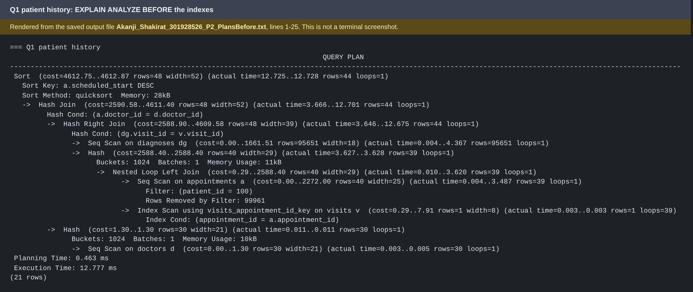
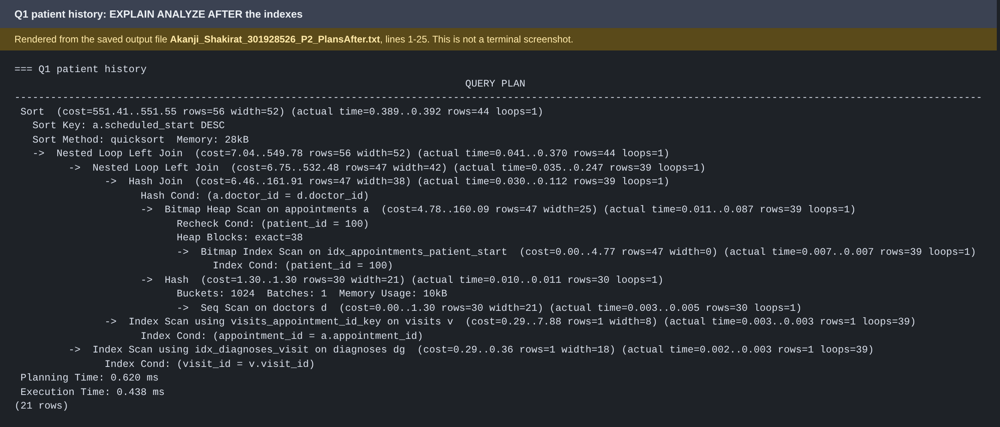
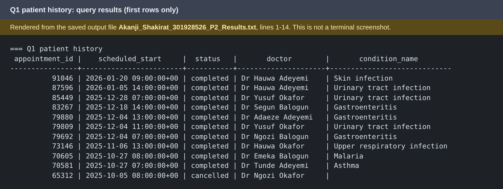

# Portfolio 2: Query Processing and Optimisation

## 1. Purpose

This portfolio shows how PostgreSQL executes queries on the CareBridge Clinics database when it holds almost 500,000 rows. I read execution plans with `EXPLAIN (ANALYZE)` [1][2], added indexes, and measured the difference. I also explain a query that indexes could not help.

## 2. Environment

PostgreSQL 16 running in Docker (`docker-compose.yml` in the repository root) on a MacBook Pro with an M1 chip. Timings come from this one machine, so the absolute numbers will differ elsewhere. The comparison between before and after is what matters.

## 3. Files in this folder

| File | Purpose |
|---|---|
| `Akanji_Shakirat_301928526_P2_SeedBulk.sql` | Generates the test data (it empties all tables first) |
| `Akanji_Shakirat_301928526_P2_ExplainQueries.sql` | The five queries, each run with `EXPLAIN (ANALYZE)` |
| `Akanji_Shakirat_301928526_P2_PlansBefore.txt` | Execution plans before adding indexes |
| `Akanji_Shakirat_301928526_P2_Indexes.sql` | The four indexes I added |
| `Akanji_Shakirat_301928526_P2_PlansAfter.txt` | Execution plans after adding indexes |
| `Akanji_Shakirat_301928526_P2_Queries.sql` | The same five queries without `EXPLAIN`, to show real results |
| `Akanji_Shakirat_301928526_P2_Results.txt` | The actual query results |
| `Akanji_Shakirat_301928526_P2_IndexSizes.txt` | Disk size of the new indexes |

## 4. Test data

`Akanji_Shakirat_301928526_P2_SeedBulk.sql` creates the data with SQL only (`generate_series` and random choices). `setseed(0.42)` makes the random numbers repeatable. All data is invented.

| Table | Rows |
|---|---|
| patients | 20,000 |
| appointments | 100,000 |
| visits | 79,882 |
| diagnoses | 95,651 |
| prescriptions | 93,510 |
| payments | 79,882 |
| lab_orders | about 24,000 |
| doctors / drugs / branches | 30 / 25 / 3 |

Patient ids are skewed on purpose, so some patients visit far more often than others, as in a real clinic. The 100,000 appointments run from January 2025 to February 2026, with unique doctor and start-time pairs so the data respects the `UNIQUE (doctor_id, scheduled_start)` rule from Portfolio 1.

## 5. Method

1. Run `Akanji_Shakirat_301928526_P2_ExplainQueries.sql` before any new index exists.
2. Each file is run **twice**. The first run only fills PostgreSQL's memory cache, so I keep the second run.
3. Create the indexes in `Akanji_Shakirat_301928526_P2_Indexes.sql`, then run `ANALYZE` so the planner has fresh statistics.
4. Run the same file again, twice, and keep the second run.
5. Compare the `Execution Time` and the shape of each plan.

`Execution Time` is the time to run the query. It does not include planning time.

## 6. The five queries

| # | Question | Why a clinic asks it |
|---|---|---|
| Q1 | Full history of one patient (appointments, doctor, diagnosis) | Opening a patient's record |
| Q2 | Completed appointments per doctor per branch in June 2025 | Workload reports for management |
| Q3 | The ten most prescribed drugs | Pharmacy stock planning |
| Q4 | Everything one patient was prescribed | Checking a patient's medicines |
| Q5 | One doctor's appointments for one week | A doctor's weekly schedule |

Q1 and Q4 use patient 100, who has 39 appointments.

## 7. Indexes added

| Index | Table | Reason |
|---|---|---|
| `idx_appointments_patient_start (patient_id, scheduled_start DESC)` | appointments | Finds one patient's appointments already sorted newest first (Q1, Q4) |
| `idx_diagnoses_visit (visit_id)` | diagnoses | Join column with no index (Q1) |
| `idx_prescriptions_visit (visit_id)` | prescriptions | Join column with no index (Q4) |
| `idx_appointments_completed_start (scheduled_start) WHERE status = 'completed'` | appointments | Partial index containing only completed appointments (Q2) [4] |

PostgreSQL builds indexes automatically for `PRIMARY KEY` and `UNIQUE` constraints, but **not for foreign keys**. That is why `diagnoses.visit_id`, `prescriptions.visit_id` and `appointments.patient_id` needed indexes of their own. I did not index `payments` or `lab_orders`, because none of the five queries uses them.

## 8. Results

| Query | Before (ms) | After (ms) | Change |
|---|---|---|---|
| Q1 patient history | 12.777 | 0.438 | about 29 times faster |
| Q2 doctor workload, June 2025 | 6.173 | 2.430 | about 2.5 times faster |
| Q3 ten most prescribed drugs | 25.708 | 26.420 | no change |
| Q4 one patient's prescriptions | 12.268 | 0.338 | about 36 times faster |
| Q5 one doctor, one week | 0.060 | 0.070 | no change (already used an index) |

What changed in the plans:

- **Before, Q1** read all 100,000 rows of `appointments` (`Rows Removed by Filter: 99961`, to return 39 rows) and all 95,651 rows of `diagnoses`.
- **Before, Q2** read all 100,000 appointments and discarded 94,230 (`Rows Removed by Filter: 94230`).
- **After**, Q1, Q2 and Q4 use the new indexes instead of sequential scans on the large tables (see `Akanji_Shakirat_301928526_P2_PlansAfter.txt`).
- **Q3 and Q5** have the same plan shape before and after.

**Evidence images for Q1.** These three images are *rendered from the saved output files* (`Akanji_Shakirat_301928526_P2_PlansBefore.txt`, `Akanji_Shakirat_301928526_P2_PlansAfter.txt` and `Akanji_Shakirat_301928526_P2_Results.txt`). They are not terminal screenshots, and each image says so. The text files hold the complete output for all five queries.

## 9. Performance analysis

**Q1 and Q4 improved the most.** They need about 39 rows out of 100,000, which is 0.04% of the table. Without an index, PostgreSQL must read everything to find them. With `idx_appointments_patient_start` it jumps straight to those rows, and the foreign-key indexes on `diagnoses` and `prescriptions` do the same for the next join.

**Q2 improved only a little.** It returns 5,770 of 100,000 rows, about 6% of the table. The partial index skips the other 94% [4], but the query still has to read, join and group those 5,770 rows. Indexes help less as the query wants a larger part of the table.

**Q3 did not improve, and cannot.** It counts prescriptions per drug across the whole table with no `WHERE` filter. An index lets PostgreSQL skip rows [3], but this query needs every row, so a sequential scan is already the cheapest plan. The 0.7 ms difference is run-to-run noise. A different approach would be needed to speed it up, such as a pre-calculated summary table or a materialised view, which would trade freshness of the data for speed. I did not test those.

**Q5 did not change.** The `UNIQUE (doctor_id, scheduled_start)` constraint from Portfolio 1 already created an index that suits this query exactly: an exact match on the doctor, then a date range. None of the new indexes applies to it. A difference of 0.010 ms is noise, not a real slowdown.

**Indexes have a cost.** Each index uses disk space (sizes are in the appendix) and has to be updated on every `INSERT`, `UPDATE` and `DELETE` on its table, which makes writes slightly slower. For that reason I only added indexes that the queries need. A clinic system with many bookings per minute should weigh this cost carefully.

**Why the milliseconds look small.** 100,000 rows is small for PostgreSQL. The time of a sequential scan grows in step with the table, while an index lookup grows very slowly, so the gap between them would be much larger on millions of rows. The number of rows read (100,000 down to a few dozen) says more than the milliseconds.

## 10. Limitations

- The dataset is small, so every timing is small.
- Q1 and Q4 test one patient (id 100). A patient with many more appointments would take longer.
- I kept the second run of each query, not an average of many runs, and everything ran on one machine.
- Differences below about 1 ms, such as Q5, are noise.
- Only B-tree indexes were tested. I did not test index-only scans, materialised views, partitioning or server settings.
- I did not measure how much the indexes slow down writes.

## 11. How to reproduce

Start the databases and load the data:

    docker compose up -d
    docker exec -i carebridge-pg psql -U carebridge -d carebridge < portfolio-1-database-design/Akanji_Shakirat_301928526_P1_Schema.sql
    docker exec -i carebridge-pg psql -U carebridge -d carebridge < portfolio-2-query-optimisation/Akanji_Shakirat_301928526_P2_SeedBulk.sql

(Skip the `Akanji_Shakirat_301928526_P1_Schema.sql` line if the tables already exist.) Run the queries before indexing, twice:

    docker exec -i carebridge-pg psql -U carebridge -d carebridge < portfolio-2-query-optimisation/Akanji_Shakirat_301928526_P2_ExplainQueries.sql > /dev/null
    docker exec -i carebridge-pg psql -U carebridge -d carebridge < portfolio-2-query-optimisation/Akanji_Shakirat_301928526_P2_ExplainQueries.sql

Add the indexes and run the queries again, twice:

    docker exec -i carebridge-pg psql -U carebridge -d carebridge < portfolio-2-query-optimisation/Akanji_Shakirat_301928526_P2_Indexes.sql
    docker exec -i carebridge-pg psql -U carebridge -d carebridge < portfolio-2-query-optimisation/Akanji_Shakirat_301928526_P2_ExplainQueries.sql > /dev/null
    docker exec -i carebridge-pg psql -U carebridge -d carebridge < portfolio-2-query-optimisation/Akanji_Shakirat_301928526_P2_ExplainQueries.sql

## 12. AI use declaration (Portfolio 2)

- **Tool used:** Claude (Anthropic).
- **Used for:** explaining how to read `EXPLAIN ANALYZE` output, drafting the data generator (`Akanji_Shakirat_301928526_P2_SeedBulk.sql`), suggesting the five queries and the four indexes, and drafting this README.
- **How I reviewed and verified it:** I ran the data generator and checked the row counts myself, ran every query before and after adding the indexes in my own Docker PostgreSQL, compared the plans and timings, and checked the claims in this README against `Akanji_Shakirat_301928526_P2_PlansBefore.txt` and `Akanji_Shakirat_301928526_P2_PlansAfter.txt`. I can explain why each index helped or did not help.

## 13. References

[1] PostgreSQL Global Development Group. *PostgreSQL 16: Using EXPLAIN.* https://www.postgresql.org/docs/16/using-explain.html

[2] PostgreSQL Global Development Group. *PostgreSQL 16: EXPLAIN.* https://www.postgresql.org/docs/16/sql-explain.html

[3] PostgreSQL Global Development Group. *PostgreSQL 16: Indexes.* https://www.postgresql.org/docs/16/indexes.html

[4] PostgreSQL Global Development Group. *PostgreSQL 16: Partial Indexes.* https://www.postgresql.org/docs/16/indexes-partial.html

## Appendix: index and table sizes

| Index | On table | Index size | Table size |
|---|---|---|---|
| idx_appointments_completed_start | appointments | 624 kB | 8176 kB |
| idx_appointments_patient_start | appointments | 3096 kB | 8176 kB |
| idx_diagnoses_visit | diagnoses | 2040 kB | 5640 kB |
| idx_prescriptions_visit | prescriptions | 1928 kB | 7368 kB |
