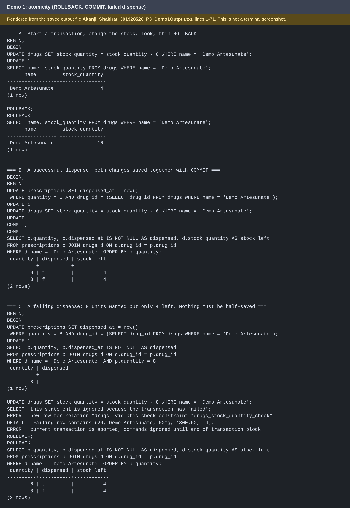

# Portfolio 3: Transactions and Concurrency

**Module:** MIT 8103 Advanced Database Systems
**Case study:** CareBridge Clinics (simulated, 3 private clinics in Oyo State)
**Database:** PostgreSQL 16 (Docker container `carebridge-pg`)

## 1. What this portfolio shows

This portfolio uses four small demonstrations to show how PostgreSQL keeps CareBridge's data correct when things fail or when many staff work at the same time.

| Demo | Idea | Clinic situation | Outcome |
|---|---|---|---|
| 1 | Atomicity, commit and rollback | Dispensing a drug: mark the prescription dispensed and reduce stock | Either both changes happen or neither does |
| 2 | Lost update and row locking | Two nurses dispense from the same stock at once | Without a lock one dispensing is lost; `FOR UPDATE` fixes it |
| 3 | Isolation levels | A report reads stock twice while another nurse dispenses | `READ COMMITTED` shows the change mid-transaction; `REPEATABLE READ` does not |
| 4 | Concurrent double-booking | Two receptionists book the same doctor and time | The second booking waits, then is rejected by the UNIQUE rule from Portfolio 1 |

All demos use one test drug, **Demo Artesunate** (stock 10), created by `Akanji_Shakirat_301928526_P3_SetupDemo.sql`, so the real seed data is untouched.

## 2. Files

| File | Purpose |
|---|---|
| `Akanji_Shakirat_301928526_P3_SetupDemo.sql` | Re-runnable reset: creates the test drug and two prescriptions on visit 1 (quantities 6 and 8) |
| `Akanji_Shakirat_301928526_P3_Demo1Atomicity.sql` | Demo 1 script (parts A, B, C) |
| `Akanji_Shakirat_301928526_P3_Demo1Output.txt` | Captured output of Demo 1 |
| `Akanji_Shakirat_301928526_P3_DemoConcurrency.sh` | Runs Demos 2 to 4: opens two database sessions (A and B) at the same time and prints a timestamped timeline |
| `Akanji_Shakirat_301928526_P3_DemoConcurrencyOutput.txt` | Captured output of Demos 2 to 4 |
| `Akanji_Shakirat_301928526_P3_SessionA.sql` | Session A steps for running Demo 2 (fix) and Demo 4 by hand in one terminal |
| `Akanji_Shakirat_301928526_P3_SessionB.sql` | Session B steps for the second terminal. Run the numbered steps alternately: A, B, A, B |
| `evidence/` | Optional screenshots of the terminal output |

## 3. How to run

```bash
docker compose -f Akanji_Shakirat_301928526_DockerCompose.yml up -d
docker exec -i carebridge-pg psql -U carebridge -d carebridge < portfolio-3-transactions-concurrency/Akanji_Shakirat_301928526_P3_SetupDemo.sql
docker exec -i carebridge-pg psql -U carebridge -d carebridge < portfolio-3-transactions-concurrency/Akanji_Shakirat_301928526_P3_Demo1Atomicity.sql
```

Demos 2 to 4 need two database sessions running at the same time. `Akanji_Shakirat_301928526_P3_DemoConcurrency.sh` starts both (session A and session B), with short pauses so they overlap in a controlled way, and merges their output by time:

```bash
bash portfolio-3-transactions-concurrency/Akanji_Shakirat_301928526_P3_DemoConcurrency.sh 2>&1 | tee portfolio-3-transactions-concurrency/Akanji_Shakirat_301928526_P3_DemoConcurrencyOutput.txt
```

To run Demo 2 (the `FOR UPDATE` fix) and Demo 4 by hand, open two `psql` terminals and follow the numbered steps in `Akanji_Shakirat_301928526_P3_SessionA.sql` and `Akanji_Shakirat_301928526_P3_SessionB.sql`, alternating A, B, A, B. Do not run the two files one after the other, because the demonstration needs the sessions to overlap.

Every output line starts with the time, so the output reads as a timeline. The results are described in sections 5 to 7 below.

## 4. Demo 1: Atomicity (commit and rollback)

**Problem.** Dispensing a drug is two changes: mark the prescription `dispensed_at`, and reduce `drugs.stock_quantity`. If only one happens, the records disagree with the shelf.

**What I ran.** Inside `BEGIN … COMMIT/ROLLBACK`:

- **A, rollback by choice.** Stock was reduced from 10 to 4 inside the transaction. After `ROLLBACK` it was back to 10.
- **B, successful commit.** The prescription was marked dispensed and stock went to 4. After `COMMIT` both changes were permanent.
- **C, failing dispense.** I tried to dispense 8 from a stock of 4. The `UPDATE` would leave stock at -4, so the `CHECK (stock_quantity >= 0)` rule from Portfolio 1 rejected it (`drugs_stock_quantity_check`). I then ran `ROLLBACK`, and the prescription's `dispensed` flag went back to false, so the earlier step in the same transaction was undone too.

**Why it matters.** Without a transaction, the prescription would stay marked "dispensed" while no stock was removed, or the reverse. The patient record would say the patient got medicine that was never given, and stock numbers would never match the shelf.

**Consistency link.** The error in part C is Consistency (the C in ACID). The database refuses a state that breaks a rule, and the rollback makes sure nothing half-finished is kept.

Evidence: `Akanji_Shakirat_301928526_P3_Demo1Output.txt`. The image below is *rendered from that saved output file*. It is not a terminal screenshot.



## 5. Demo 2: Lost update

**Problem.** Stock is 10. Nurse A dispenses 6 and Nurse B dispenses 4, at the same moment. The correct final stock is 0.

**Part 1, no protection.** Both sessions ran `BEGIN` and read the stock. Both saw 10. A wrote 4 and committed. B, still working from its old reading of 10, wrote 6 and committed. **Final stock: 6.** A's dispensing was overwritten and lost.

**Part 2, with `SELECT … FOR UPDATE`.** A read the stock with `FOR UPDATE`, which locks the row. When B ran the same statement it **froze and waited**. After A committed (stock 4), B unfroze and saw **4**, not 10. B then wrote 0. **Final stock: 0**, which is correct.

**Why it works.** `FOR UPDATE` makes the second session queue behind the first [2], so it always works from the latest value. The cost is that sessions wait, which is acceptable for short transactions like dispensing.

**Alternative.** A single atomic statement such as `UPDATE drugs SET stock_quantity = stock_quantity - 4 WHERE …` also avoids the problem, because the arithmetic happens inside the database. `FOR UPDATE` is needed when the application must read the value, make a decision, and then write.

Evidence: Demo 2 parts 1 and 2 in `Akanji_Shakirat_301928526_P3_DemoConcurrencyOutput.txt`.

## 6. Demo 3: Isolation levels

**Problem.** Isolation controls what one transaction can see of another's work while both are running [1]. I tested a *non-repeatable read*: reading the same row twice in one transaction and getting two different answers.

**Setup.** Session A starts a transaction and reads stock (10). Session B then dispenses 3 and commits. Session A reads stock again.

| Level | A's first read | A's second read | What it means |
|---|---|---|---|
| `READ COMMITTED` (PostgreSQL default) | 10 | **7** | Each statement sees the latest committed data, so the value changed inside A's transaction |
| `REPEATABLE READ` | 10 | **10** | A works from one snapshot taken at its first query, so it is not affected by B's commit |

**When to use which.** `READ COMMITTED` is fine for ordinary work such as booking or dispensing, where each statement should see current data. `REPEATABLE READ` suits reports that must be internally consistent, for example an end-of-day stock count that reads several tables and must not drift while it runs.

**Trade-off.** Stronger isolation gives more consistent views, but a `REPEATABLE READ` transaction that tries to update a row changed by someone else after its snapshot is aborted with a serialization error [1] and must be retried.

Evidence: the two Demo 3 runs in `Akanji_Shakirat_301928526_P3_DemoConcurrencyOutput.txt`.

## 7. Demo 4: Concurrent double-booking

**Problem.** Two receptionists book Dr 1 at the same time slot for different patients. In Portfolio 1 I added `UNIQUE (doctor_id, scheduled_start)` on `appointments` to prevent exactly this [3].

**What happened.** Session A inserted the booking and had not yet committed. Session B inserted the same doctor and time. B **did not fail immediately; it waited**, because PostgreSQL could not yet know whether A's booking would stick. When A committed, B failed with:

```
ERROR: duplicate key value violates unique constraint "appointments_doctor_id_scheduled_start_key"
DETAIL: Key (doctor_id, scheduled_start)=(1, 2030-01-01 09:00:00+01) already exists.
```

A final count showed exactly **1** booking for that doctor and slot.

**Why it matters.** A "check if free, then insert" check in application code is not safe, because both receptionists can check at the same moment and both see "free". The database constraint closes that gap, so the rule holds under concurrency without any extra code. If A had rolled back instead, B's insert would have succeeded.

Evidence: Demo 4 in `Akanji_Shakirat_301928526_P3_DemoConcurrencyOutput.txt`.

## 8. ACID summary

| Property | Where shown |
|---|---|
| Atomicity | Demo 1 (parts A and C) |
| Consistency | Demo 1 part C (CHECK rule), Demo 4 (UNIQUE rule) |
| Isolation | Demos 2, 3 and 4 |
| Durability | Not tested here (see limitations) |

## 9. Limitations

- Demos use one test drug and a few rows, so they show the mechanisms, not performance at scale.
- Durability (committed data surviving a crash) was not separately tested.
- Deadlocks (two sessions each waiting on the other) and the `SERIALIZABLE` level were not covered.
- The demos use fixed pauses to make sessions overlap, so they show the mechanisms but are not automated tests.

## 10. AI-Use Declaration

- **Tool used:** Claude (Anthropic), via Claude Code.
- **What for:** Claude proposed the demo scenarios, wrote the SQL scripts and the step-by-step instructions, and drafted this README.
- **How I checked it:** I ran every script and every two-terminal step myself on my own PostgreSQL 16 container and compared the output with what was described. I checked that the errors came from the rules I created in Portfolio 1. I can explain each result in my own words.

## 11. References

[1] PostgreSQL Global Development Group. *PostgreSQL 16: Transaction Isolation.* https://www.postgresql.org/docs/16/transaction-iso.html Accessed 8 November 2026.

[2] PostgreSQL Global Development Group. *PostgreSQL 16: Explicit Locking* (`SELECT ... FOR UPDATE`). https://www.postgresql.org/docs/16/explicit-locking.html Accessed 8 November 2026.

[3] PostgreSQL Global Development Group. *PostgreSQL 16: Constraints* (unique constraints). https://www.postgresql.org/docs/16/ddl-constraints.html Accessed 8 November 2026.
