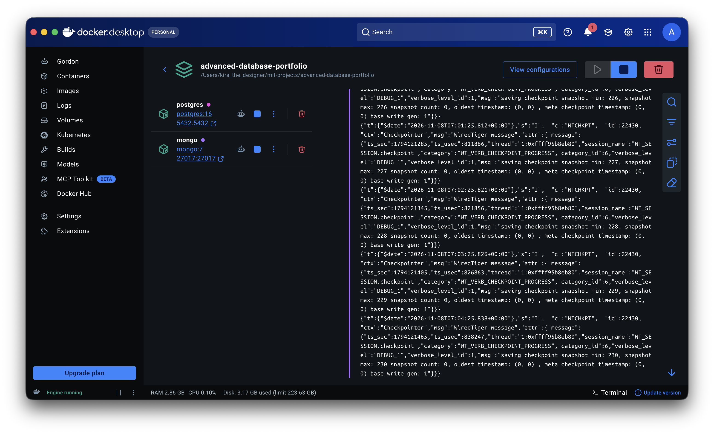
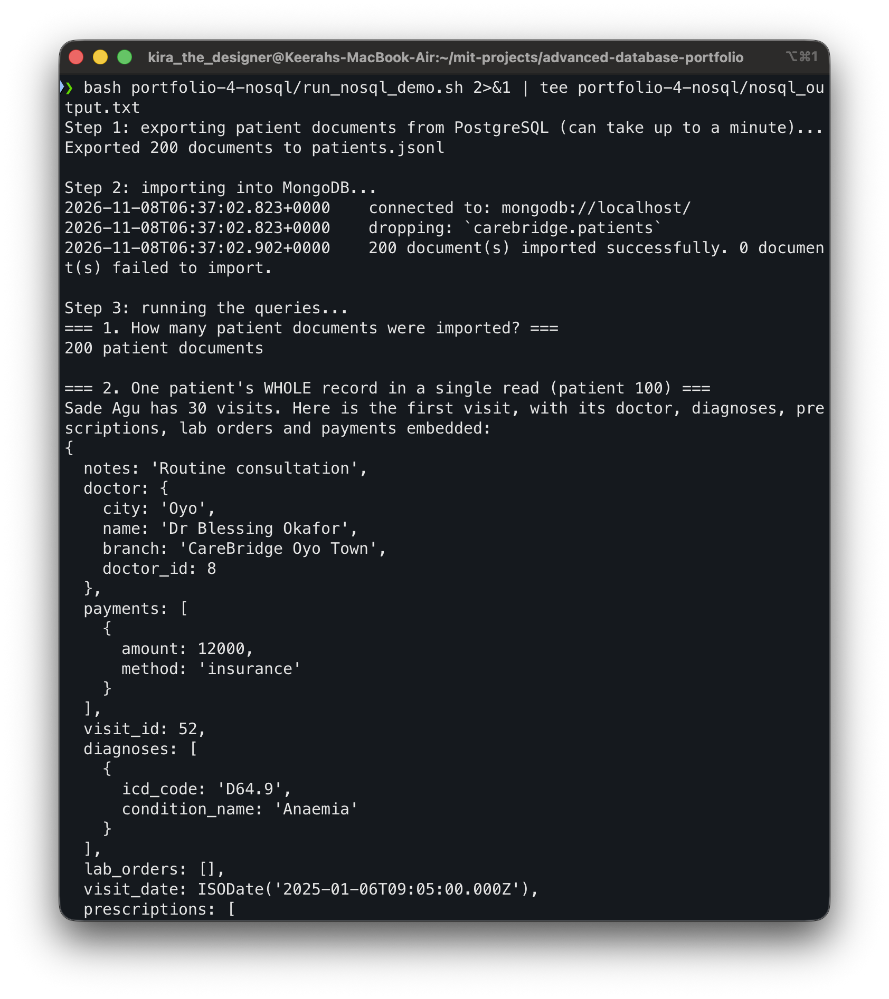
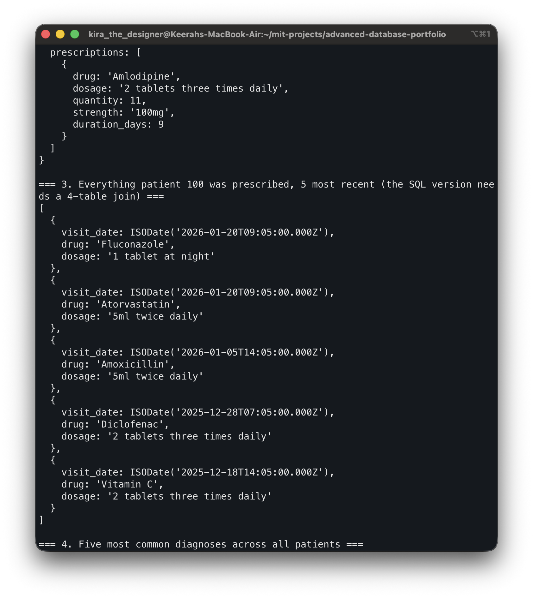
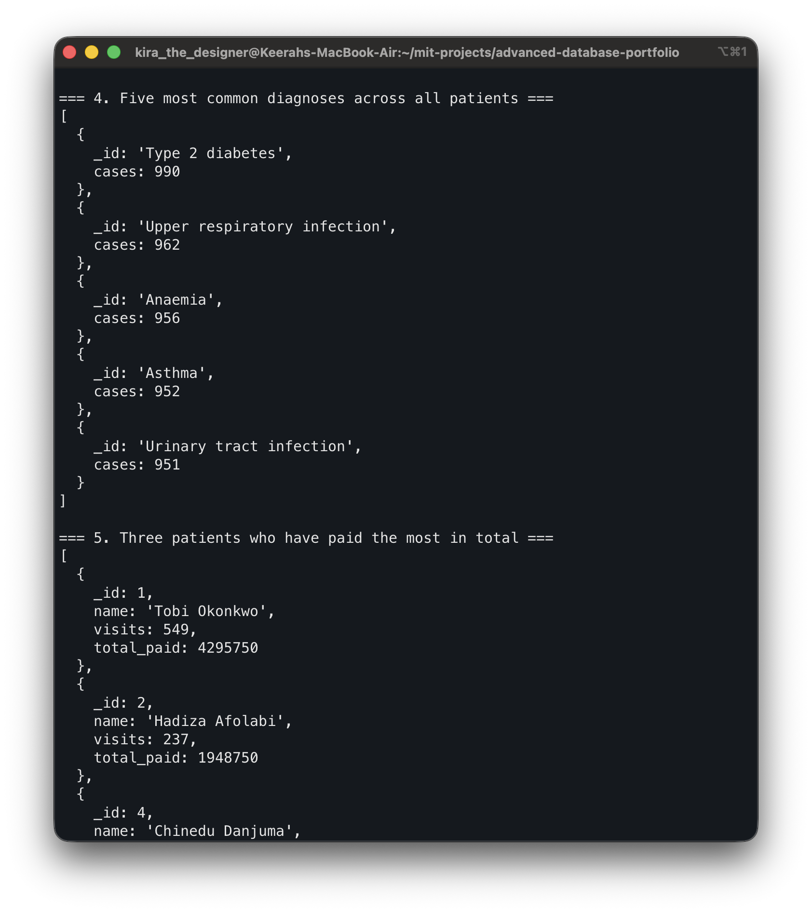
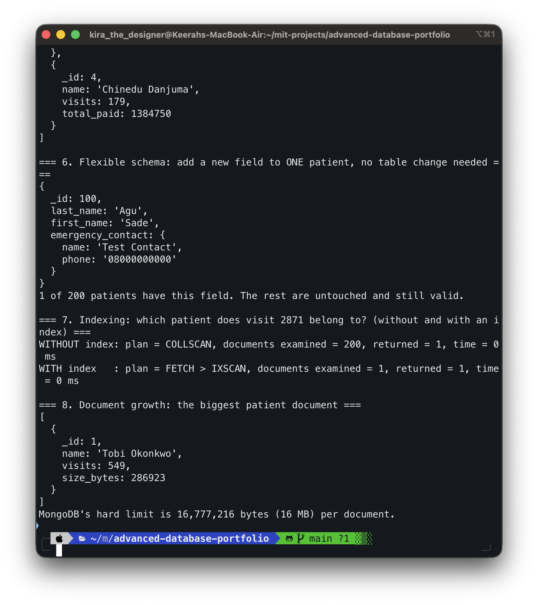

# Portfolio 4: NoSQL Data Model (MongoDB)

**Module:** MIT 8103 Advanced Database Systems
**Case study:** CareBridge Clinics (simulated, 3 private clinics in Oyo State)
**NoSQL type:** Document database, MongoDB 7 (Docker container `carebridge-mongo`)

## 1. What this portfolio shows

In Portfolio 1 the CareBridge data was split across 11 tables. To read one patient's full history in PostgreSQL, a query must join several of them. In this portfolio I remodel the same data as MongoDB **documents**, where each patient is one document that contains their visits, and each visit contains its doctor, diagnoses, prescriptions, lab orders and payments. I then import 200 patients, run eight queries, and discuss when this model is and is not a good fit.

## 2. Files

| File | Purpose |
|---|---|
| `Akanji_Shakirat_301928526_P4_ExportPatients.sql` | Reads the PostgreSQL data and builds one JSON document per patient (first 200 patients) |
| `Akanji_Shakirat_301928526_P4_Patients.jsonl` | The exported documents, one per line |
| `Akanji_Shakirat_301928526_P4_Queries.js` | Eight MongoDB queries (mongosh) |
| `Akanji_Shakirat_301928526_P4_RunNosqlDemo.sh` | Runs export, import and queries in one command |
| `Akanji_Shakirat_301928526_P4_NosqlOutput.txt` | Captured output of the run |

## 3. How to run

```bash
docker compose up -d
bash portfolio-4-nosql/Akanji_Shakirat_301928526_P4_RunNosqlDemo.sh 2>&1 | tee portfolio-4-nosql/Akanji_Shakirat_301928526_P4_NosqlOutput.txt
```

The script (1) exports the patient documents from PostgreSQL, (2) imports them with `mongoimport --drop` into `carebridge.patients`, and (3) runs `Akanji_Shakirat_301928526_P4_Queries.js` with `mongosh`. Re-running it resets the data, because of `--drop`.

## 4. The document model

```
patient (one document)
├── _id, first_name, last_name, sex, phone, address, date_of_birth, registered_at
└── visits [ ... ]                       (embedded array, oldest first)
    ├── visit_id, visit_date, notes
    ├── doctor { doctor_id, name, branch, city }     (embedded copy)
    ├── diagnoses [ { condition_name, icd_code } ]
    ├── prescriptions [ { drug, strength, dosage, duration_days, quantity } ]
    ├── lab_orders [ { test_name, result } ]
    └── payments [ { amount, method } ]
```

### Design decisions: embed or reference?

| Data | Choice | Reason |
|---|---|---|
| Visits inside a patient | **Embedded** | A clinician reads a patient's history as one unit, so one read returns everything |
| Diagnoses, prescriptions, lab orders, payments inside a visit | **Embedded** | They only make sense as part of that visit and are always read with it |
| Doctor inside a visit | **Embedded copy** (id, name, branch, city) | The visit shows who treated the patient without another lookup. The cost is duplication, see section 7 |
| Drug stock and prices | **Not in these documents** | Stock changes constantly and needs the safe concurrent updates shown in Portfolio 3, so it stays in PostgreSQL |

Dates are stored as real MongoDB dates (the export uses extended JSON `{"$date": ...}`), so date comparisons and sorting work correctly. The queries printed them as `ISODate(...)`.

## 5. Results

All output is in `Akanji_Shakirat_301928526_P4_NosqlOutput.txt`.

**Query 1: import check.** 200 patient documents, 0 failed.

**Query 2: a whole record in one read.** `findOne({_id: 100})` returned Sade Agu with 30 visits. The first visit came back with its doctor (Dr Blessing Okafor, CareBridge Oyo Town), diagnosis (Anaemia, D64.9), prescription (Amlodipine) and payment (12,000, insurance) all inside it. In SQL, the same view needs joins across appointments, visits, doctors, branches, diagnoses, prescriptions and payments.

**Query 3: everything one patient was prescribed.** An aggregation with `$match`, two `$unwind` stages, `$sort` and `$limit` returned the five most recent prescriptions for patient 100 (for example Fluconazole and Atorvastatin on 2026-01-20). This is the same question as Query 4 in Portfolio 2, which needed a four-table join in SQL. In MongoDB no join is needed, because the data already sits together.

**Query 4: most common diagnoses.** Type 2 diabetes (990), Upper respiratory infection (962), Anaemia (956), Asthma (952), Urinary tract infection (951). Counting across all patients means unwinding every visit's array, which is more work than a simple `GROUP BY` in SQL.

**Query 5: top payers.** The three patients with the highest total payments were patient 1 (549 visits, total 4,295,750), patient 2 (237 visits, 1,948,750) and patient 4 (179 visits, 1,384,750). The visit counts are very uneven because the simulated data deliberately has a few very frequent visitors (see section 6, Query 8).

**Query 6: flexible schema.** I added an `emergency_contact` field to one patient with `updateOne`. Only that document changed (1 of 200 patients has the field), and the other 199 stayed valid with no table change. In PostgreSQL this would be `ALTER TABLE` on the whole table.

**Query 7: indexing.** Looking up which patient owns visit 2871:

| | Plan | Documents examined | Returned |
|---|---|---|---|
| Without index | `COLLSCAN` | 200 | 1 |
| With index on `visits.visit_id` | `FETCH > IXSCAN` | 1 | 1 |

This is the same idea as Portfolio 2: a collection scan reads everything, an index scan jumps to the match. Time showed 0 ms in both cases because only 200 documents are stored, so the difference in documents examined is the real evidence, not the milliseconds. MongoDB indexes array fields (a multikey index), so one index covers the visit ids inside every patient's `visits` array.

**Query 8: document growth.** The biggest document is patient 1 with 549 visits, at 286,923 bytes (about 0.29 MB). MongoDB's limit is 16 MB per document, so this one is under 2% of the limit. The visit counts in my data are artificially skewed, but the point is real: an embedded array that grows forever eventually becomes a problem.

## 6. Evidence

These screenshots are from my own terminal, taken while I ran the demo. The full text output is also saved in `Akanji_Shakirat_301928526_P4_NosqlOutput.txt`. Screenshots are in the `evidence/` folder.

**Both containers running** (`docker ps`: `carebridge-pg` and `carebridge-mongo`)


**Export from PostgreSQL, import into MongoDB (200 imported, 0 failed), and Queries 1 and 2** (document count, one patient's whole record)


**Query 2 (embedded visit) and Query 3** (everything patient 100 was prescribed)


**Queries 4 and 5** (most common diagnoses, top payers)


**Queries 6, 7 and 8** (flexible schema, `COLLSCAN` vs `IXSCAN`, document size)


## 7. Why a document database suits this data (and where it does not)

**Good fit:**
- **Reading a patient's history is the main job.** One read returns the whole record, with no joins, which is fast and simple for clinical screens.
- **Flexible records.** Different patients and clinics may need different fields (Query 6), without migrating every row.
- **Natural shape.** The data is already nested: a patient has visits, a visit has diagnoses and prescriptions.
- **Easier horizontal scaling.** A document is a self-contained unit, so documents can be spread across servers by patient id (discussed in Portfolio 5).

**Weak fit:**
- **Duplicated data.** The doctor's name is copied into every visit. If a doctor's name changes, many documents must be updated, which is easy to get wrong. In PostgreSQL the name lives in one row.
- **Cross-patient questions are harder.** Query 4 and Query 5 need `$unwind` and nested expressions. Reporting is more natural in SQL.
- **Unbounded growth.** Visits keep being added to the same document (Query 8). A very long-lived patient could eventually approach the 16 MB limit, so a real system might move older visits into a separate collection.
- **Weaker guarantees.** There are no foreign keys, so nothing stops a visit from referencing a doctor that does not exist. Money and stock, which Portfolio 3 showed need strict transactions and constraints, belong in the relational database.
- **A snapshot.** The MongoDB documents are copied from PostgreSQL and are not kept in sync. A real system would need a pipeline to keep both updated.

**Conclusion for CareBridge:** a good design is **both**. PostgreSQL stays the system of record for appointments, billing and drug stock, where correctness under concurrency matters. MongoDB holds the patient-record view for fast reads.

## 8. Other NoSQL types and CareBridge

| Type | Example product | Possible CareBridge use | Why |
|---|---|---|---|
| Key-value | Redis | Cache of today's appointment slots, or login sessions | Very fast lookups by a single key, no relationships needed |
| Column-family | Cassandra | Continuous vital-sign readings from monitors | Huge volumes of time-ordered writes that are read by time range |
| Graph | Neo4j | Referral networks between doctors, or tracing contacts in an outbreak | The questions are about relationships and paths, not rows |

I chose the document type for the implementation because patient records are the core of the case study and fit it best. The other three are described, not implemented.

## 9. Limitations

- Only 200 of the 20,000 patients were exported, so timing differences are tiny. The evidence is the documents examined, not the milliseconds.
- The export is a one-time snapshot, not a live sync.
- MongoDB runs without authentication in Docker, which is fine for this assignment but not for real patient data.
- Replication and sharding for MongoDB are covered in Portfolio 5.

## 10. AI-Use Declaration

- **Tool used:** Claude (Anthropic), via Claude Code.
- **What for:** Claude proposed the document structure, wrote the export SQL, the `mongosh` queries and the run script, and drafted this README, from the output of the scripts I ran. I reviewed the README against my own results.
- **How I checked it:** I ran the script on my own machine against my own PostgreSQL and MongoDB containers, confirmed 200 documents imported with 0 failures, read the query results, and compared patient 100's embedded record with the same patient's rows in PostgreSQL. I can explain the model, the queries and the trade-offs in my own words.

## 11. References

- MongoDB Manual, *Data Modeling* (embedded vs referenced documents): https://www.mongodb.com/docs/manual/data-modeling/
- MongoDB Manual, *Aggregation pipeline* (`$unwind`, `$group`, `$project`): https://www.mongodb.com/docs/manual/core/aggregation-pipeline/
- MongoDB Manual, *Multikey indexes*: https://www.mongodb.com/docs/manual/core/indexes/index-types/index-multikey/
- MongoDB Manual, *Limits and thresholds* (16 MB document size): https://www.mongodb.com/docs/manual/reference/limits/
