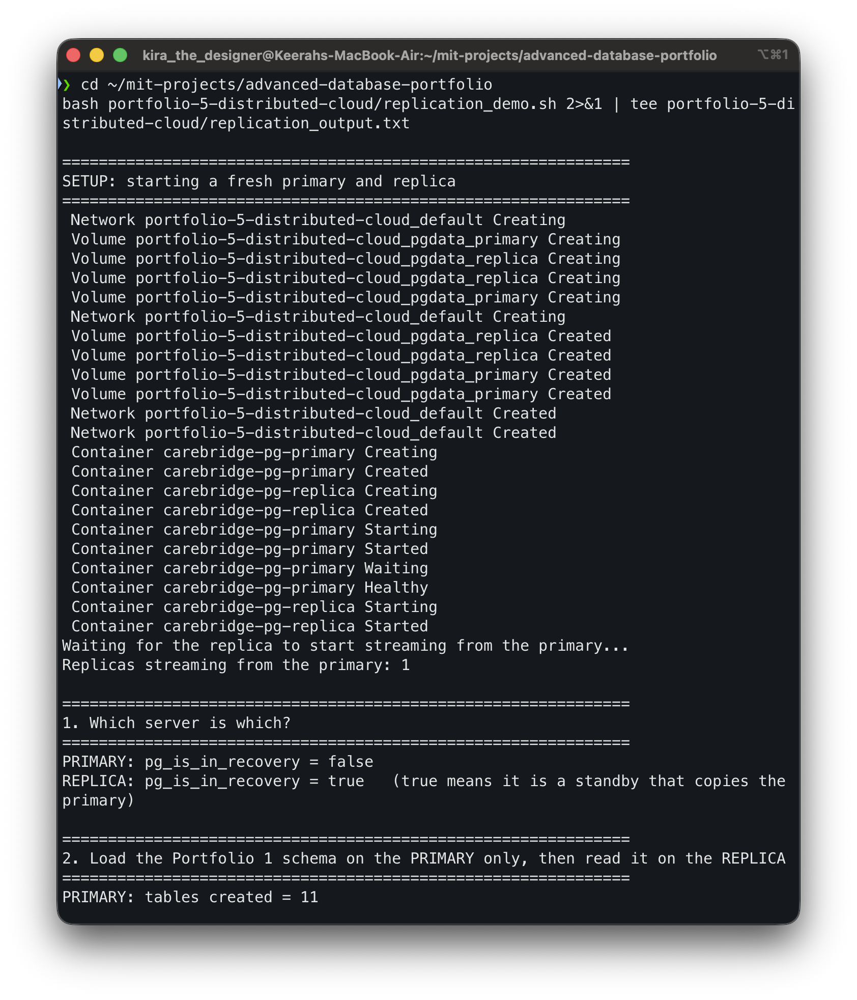
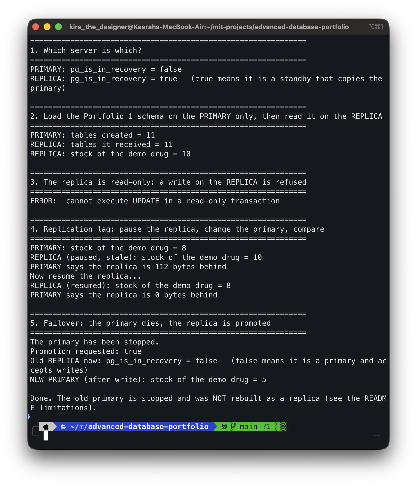
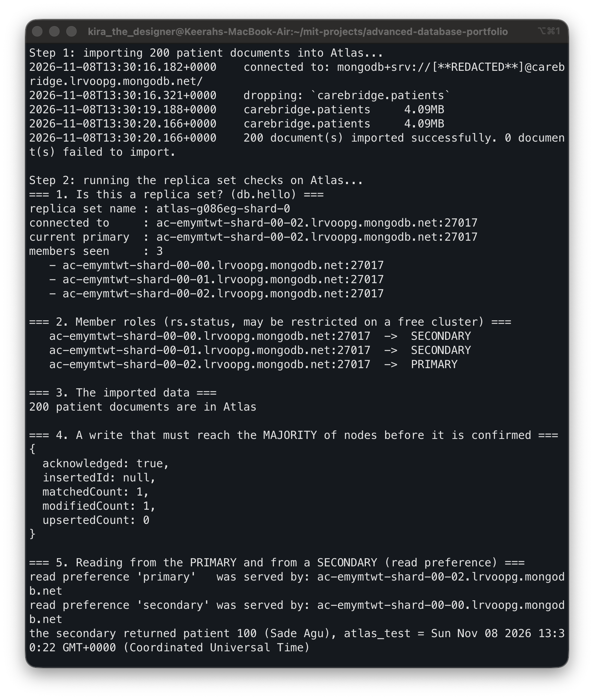
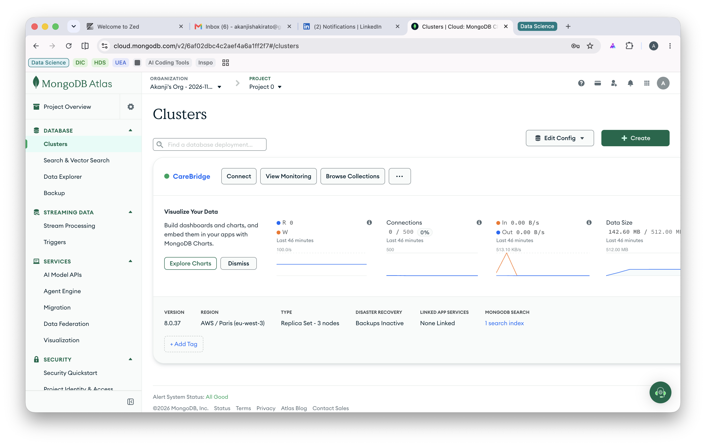

# Portfolio 5: Distributed Databases and Cloud Deployment

**Module:** MIT 8103 Advanced Database Systems
**Case study:** CareBridge Clinics (simulated, 3 private clinics in Oyo State)
**Implemented:** PostgreSQL 16 primary-replica replication with failover (Docker), and a MongoDB Atlas replica set (cloud)
**Discussed:** sharding, availability, consistency and the CAP trade-off

## 1. What this portfolio shows

A single database server is a single point of failure and a limit on how many reads it can serve. This portfolio shows two ways to spread CareBridge's data across several servers:

1. **PostgreSQL replication on Docker.** A primary server copies every change to a replica. I show that the replica receives the data, refuses writes, can fall behind (replication lag), and can be promoted when the primary dies (failover).
2. **A MongoDB Atlas replica set in the cloud.** I loaded the patient documents from Portfolio 4 into a managed 3-node cluster and checked its members, a majority write, and reads from a secondary.

Sharding is covered as a written design discussion (section 6).

## 2. Files

| File | Purpose |
|---|---|
| `docker-compose.replication.yml` | Starts a PostgreSQL primary and a replica (separate from the main `docker-compose.yml`) |
| `Akanji_Shakirat_301928526_P5_InitPrimary.sql` | Runs once on the primary: creates the replication user and allows it to connect |
| `Akanji_Shakirat_301928526_P5_ReplicationDemo.sh` | Runs the five replication demos |
| `Akanji_Shakirat_301928526_P5_ReplicationOutput.txt` | Captured output of the replication demo |
| `Akanji_Shakirat_301928526_P5_AtlasDemo.sh` | Imports the patient documents into Atlas and runs the checks |
| `Akanji_Shakirat_301928526_P5_AtlasChecks.js` | The `mongosh` checks run against Atlas |
| `Akanji_Shakirat_301928526_P5_AtlasOutput.txt` | Captured output of the Atlas run (connection string and password hidden) |
| `evidence/` | Terminal and Atlas dashboard screenshots |

## 3. How to run

**PostgreSQL replication** (about 1 to 2 minutes; recreates both containers every run):
```bash
bash portfolio-5-distributed-cloud/Akanji_Shakirat_301928526_P5_ReplicationDemo.sh 2>&1 | tee portfolio-5-distributed-cloud/Akanji_Shakirat_301928526_P5_ReplicationOutput.txt
```

**MongoDB Atlas** (needs a free Atlas cluster, a database user, and an IP access list entry; the script asks for the connection string and hides it, so it is never saved):
```bash
bash portfolio-5-distributed-cloud/Akanji_Shakirat_301928526_P5_AtlasDemo.sh 2>&1 | tee portfolio-5-distributed-cloud/Akanji_Shakirat_301928526_P5_AtlasOutput.txt
```

## 4. PostgreSQL primary-replica replication

### Setup
Two containers run PostgreSQL 16 with streaming replication [1]. The **primary** (`carebridge-pg-primary`) accepts reads and writes. The **replica** (`carebridge-pg-replica`) is created by `pg_basebackup` [2], which copies the primary's data and marks the new server as a standby. It then **streams** the primary's write-ahead log (WAL) continuously and replays it. The replication is **asynchronous**: the primary confirms a write without waiting for the replica.

### Results

| # | Demo | Result |
|---|---|---|
| 1 | Roles | Primary: `pg_is_in_recovery = false`. Replica: `pg_is_in_recovery = true` (a standby) |
| 2 | Data copied | The Portfolio 1 schema was loaded on the primary only. The replica received all 11 tables and the demo drug row (stock 10) |
| 3 | Replica is read-only | `UPDATE` on the replica failed: `ERROR: cannot execute UPDATE in a read-only transaction` |
| 4 | Replication lag | With replay paused on the replica [3], the primary changed stock 10 to 8. The primary showed **8**, the paused replica still showed **10** (stale), and the primary reported the replica **112 bytes behind**. After resuming, the replica showed **8** and was **0 bytes behind** |
| 5 | Failover | The primary was stopped and the replica was promoted with `pg_promote()` [3]. It reported `pg_is_in_recovery = false`, accepted a write, and the stock read **5** |

### What this means for CareBridge
- **Read scaling and backup copy.** Reports and dashboards can read from the replica, so they do not slow down the primary that clinic staff write to.
- **Stale reads are possible.** Demo 4 shows the trade-off: a read from the replica can return older data than the primary. For a dispensing screen that checks stock, that would be wrong, so those reads must go to the primary (the problem from Portfolio 3).
- **Failover keeps the system available**, but with caveats: writes that the primary had accepted but not yet sent to the replica can be lost when the primary dies (a risk of asynchronous replication, not measured here), and the old primary cannot simply be restarted as a primary, because there would then be two servers that both accept writes (split brain). It has to be rebuilt as a replica of the new primary.

## 5. MongoDB Atlas replica set (cloud deployment)

### Deployment
I created a free (M0) cluster on MongoDB Atlas, a database user, and an IP access list entry. The 200 patient documents exported in Portfolio 4 were imported into it with `mongoimport` (4.09 MB, 200 imported, 0 failed). The run output hides the connection string and password.

### Results

| # | Check | Result |
|---|---|---|
| 1 | Replica set | Name `atlas-g086eg-shard-0`, **3 members** seen, one current primary |
| 2 | Member roles | `rs.status()` worked: 2 members `SECONDARY` and 1 `PRIMARY` |
| 3 | Data | 200 patient documents in the cloud collection |
| 4 | Majority write | `updateOne` with write concern `w: "majority"` [5] returned `acknowledged: true`, `modifiedCount: 1`. The write was confirmed only after most nodes had it |
| 5 | Read preference | A read with preference `primary` [6] was served by the primary node. A read with preference `secondary` was served by a **different** node, and it already returned the field written in check 4 |

### What this means for CareBridge
- **Availability.** With 3 nodes, the cluster keeps working if one node fails, because the remaining two are still a majority and can elect a new primary [4]. I did not trigger a failover on Atlas, so this is how the design works, not something I measured.
- **Consistency is a setting.** Writing with `w: "majority"` and reading from the primary gives the strongest guarantee. Reading from a secondary spreads load but can return slightly older data, the same trade-off as the PostgreSQL replica in section 4. In my test the secondary already had the new value, because the replication was fast.
- **Managed service.** Atlas runs the nodes, networking and failover for me. In exchange, data lives on the provider's servers in a region I chose. For real patient data, the region and the Nigeria Data Protection Act would have to be considered.

## 6. Sharding (design discussion, not implemented)

**Replication copies the same data to every node. Sharding splits the data so each node holds only part of it.** [7] It is used when the data or the write load is too big for one machine. I did not implement it: CareBridge's data is small, and my Atlas cluster is a single replica set.

If CareBridge grew to many clinics, a good design would be:

| Option | How it works | Good | Problem |
|---|---|---|---|
| Shard by **branch** | One shard per clinic or region | Data stays near the clinic, simple to explain | Only 3 branches, so very uneven, and the busiest clinic becomes a hot spot |
| Shard by **hashed patient id** | A hash of the id decides the shard | Even spread, and one patient's whole record is on one shard | Reports across all patients must ask every shard (scatter-gather) |
| Shard by **time** | Newest visits on one shard | Easy to archive old data | The newest shard takes all the writes |

**Recommendation:** hashed patient id for the patient-record collection from Portfolio 4. A patient's document is read as a unit, so a single-patient lookup touches one shard. Cross-patient reports (like Queries 4 and 5 in Portfolio 4) would be slower. In PostgreSQL, the equivalent would be table partitioning or an extension that distributes tables across servers.

## 7. Availability, consistency and the CAP trade-off

The CAP idea [8] says that when a network failure splits a distributed system, it must choose between **consistency** (every read sees the latest write) and **availability** (every request gets an answer).

| System | Behaviour | Choice |
|---|---|---|
| PostgreSQL primary | One server accepts writes, so writes are consistent. If it is unreachable, writes stop until a failover | Consistency over availability for writes |
| PostgreSQL replica reads | Always answers, but can be stale (Demo 4) | Availability over consistency for reads |
| Atlas `w: "majority"` and primary reads | A write succeeds only when most nodes have it | Consistency |
| Atlas secondary reads | Spreads load, can be slightly behind | Availability and performance over freshness |

**For CareBridge:** drug stock, payments and appointment booking must use the primary (consistency matters, as Portfolio 3 showed). Dashboards, reports and patient history screens can read from replicas or secondaries, where a few seconds of delay is acceptable.

## 8. Evidence

Screenshots are from my own terminal and the Atlas dashboard. The full text output is in `Akanji_Shakirat_301928526_P5_ReplicationOutput.txt` and `Akanji_Shakirat_301928526_P5_AtlasOutput.txt`.

**Replication starts and the roles are correct** (primary and replica streaming, schema received)


**Replication lag, then failover** (stale read of 10, caught up to 8, replica promoted)


**Atlas import and replica set checks** (3 members, majority write, secondary read)


**Atlas dashboard** (the running cluster)


## 9. Limitations

- **Failover was manual.** I promoted the replica myself. A production setup would use a tool that detects the failure and promotes automatically.
- **The old primary was not rebuilt as a replica**, so the demo ends with one server.
- **Asynchronous replication can lose the latest writes** if the primary dies before they reach the replica. I did not measure this.
- **No failover test on Atlas**, and no sharding on either system.
- **Security shortcuts.** The Docker replication password is a lab value, and the Atlas IP access list was opened to all addresses for the assignment. Neither is acceptable for real patient data. The data here is simulated.
- **Small data.** Replication lag and read-preference behaviour are shown, not benchmarked under load.

## 10. AI-Use Declaration

- **Tool used:** Claude (Anthropic), via Claude Code.
- **What for:** Claude proposed the replication and Atlas demos, wrote the Docker Compose file, the scripts and the checks, helped me debug setup problems (for example a script permission error in the Docker container and an Atlas network access error), and drafted this README from the output of the scripts I ran.
- **How I checked it:** I ran every script myself on my own machine and my own Atlas cluster, read each result, and compared it with the behaviour described above. The password in one error message was exposed, so I deleted that output, changed the Atlas password, and the script now hides it. I can explain replication, lag, failover, majority writes and the sharding options in my own words.

## 11. References

[1] PostgreSQL Global Development Group. *PostgreSQL 16: Log-Shipping Standby Servers* (streaming replication). https://www.postgresql.org/docs/16/warm-standby.html Accessed 8 November 2026.

[2] PostgreSQL Global Development Group. *PostgreSQL 16: pg_basebackup.* https://www.postgresql.org/docs/16/app-pgbasebackup.html Accessed 8 November 2026.

[3] PostgreSQL Global Development Group. *PostgreSQL 16: System Administration Functions* (`pg_wal_replay_pause`, `pg_promote`). https://www.postgresql.org/docs/16/functions-admin.html Accessed 8 November 2026.

[4] MongoDB. *Replication.* https://www.mongodb.com/docs/manual/replication/ Accessed 8 November 2026.

[5] MongoDB. *Write Concern.* https://www.mongodb.com/docs/manual/reference/write-concern/ Accessed 8 November 2026.

[6] MongoDB. *Read Preference.* https://www.mongodb.com/docs/manual/core/read-preference/ Accessed 8 November 2026.

[7] MongoDB. *Sharding.* https://www.mongodb.com/docs/manual/sharding/ Accessed 8 November 2026.

[8] Brewer, E. (2012). CAP twelve years later: How the "rules" have changed. *IEEE Computer*, 45(2), 23-29. Accessed 8 November 2026.
